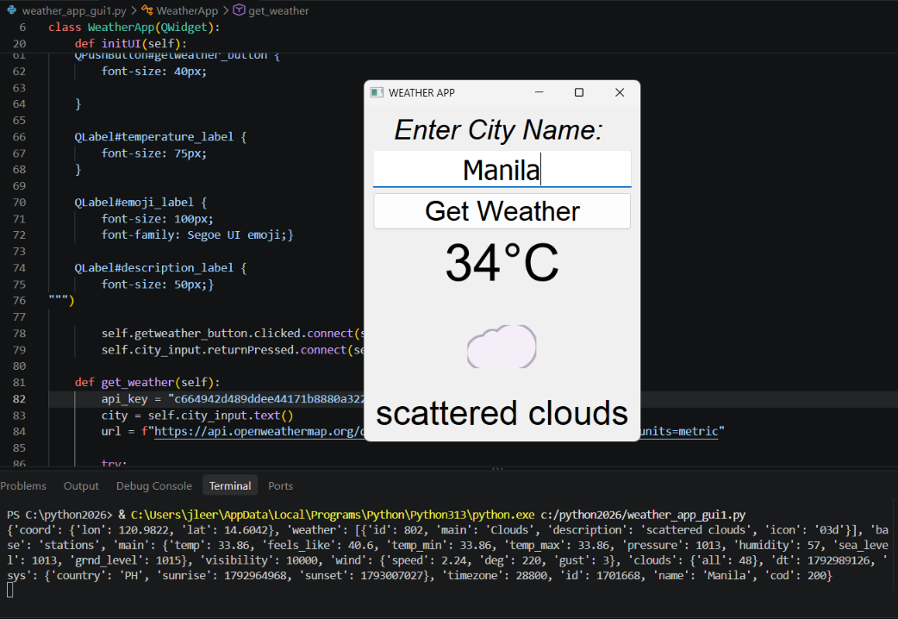

🌤️ Python Weather App

A desktop weather application developed using Python and PyQt5. It allows users to search for cities and view real-time weather information using the OpenWeatherMap API.

📌 Features
- Search for weather by city name
- Display real-time temperature in Celsius (°C)
- Show weather conditions using emojis
- Display weather descriptions
- Search by clicking the Get Weather button or pressing Enter
- Handle invalid city names, connection errors, and API errors

🛠️ Technologies Used
- Python
- PyQt5 – Graphical User Interface (GUI)
- OpenWeatherMap API – Real-time weather data
- Requests – Fetching data from the API
  
🚀 How to Run
1. Install Python.
2. Download or clone this repository.
3. Install the required libraries:

   `pip install PyQt5 requests`

4. Set the `OPENWEATHER_API_KEY` environment variable with your own OpenWeatherMap API key.
5. Run the application:

   `python weather_app_gui.py`
   
📸 Application Screenshot

📥 Download Weather App

Download the latest version of my Python Weather App for Windows.

[Download Weather App](https://github.com/cabilingjohnroy/Python-Weather-App/releases/latest)

Requirements
- Windows 10 or 11
- Internet connection
- OpenWeatherMap API key configured as `OPENWEATHER_API_KEY`

🎯 Project Purpose
This project was created to practice Python programming, GUI development, API integration, and error handling. It demonstrates how to build an interactive desktop application using real-time data.
  
